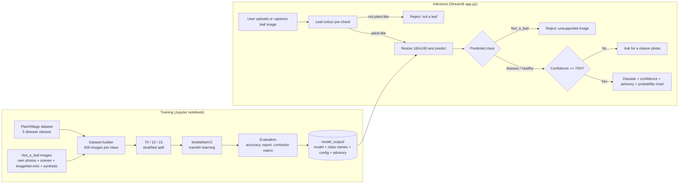

# 🌿 AI-Based Crop Disease Detection and Advisory

An end-to-end deep learning system that looks at a photo of a crop leaf, tells you **which disease it has (or whether it is healthy)**, shows how **confident** the model is, and gives **plain-language advice** on symptoms, prevention and next steps. It also **rejects images that are not leaves** (selfies, road signs, objects) instead of forcing them into a disease class.

Built with **MobileNetV2 transfer learning (TensorFlow / Keras)** and served through a **Streamlit** web app.


---

## 📌 Table of Contents
1. [Features](#-features)
2. [Demo](#-demo)
3. [Supported Classes](#-supported-classes)
4. [System Architecture](#-system-architecture)
5. [Workflow](#-workflow)
6. [Model Architecture](#-model-architecture)
7. [Dataset](#-dataset)
8. [Results](#-results)
9. [Project Structure](#-project-structure)
10. [Limitations](#-limitations)


---

## ✨ Features

- **Disease classification** of tomato, potato and bell pepper leaves with **95% test accuracy**.
- **Not-a-leaf rejection**: a dedicated `Not_a_leaf` class plus a quick colour-based pre-check stops non-leaf images from getting a disease prediction.
- **Confidence score** with a threshold (70%). Low-confidence predictions ask the user for a clearer photo instead of guessing.
- **Advisory engine**: symptoms, preventive practices and recommended next steps for each class (loaded from `advisory.csv`).
- **Two input modes**: upload an image or capture one with the camera.
- **Probability chart** showing the model's score for every class.
- **Lightweight**: MobileNetV2 at 160×160 trains and runs on a normal CPU, no GPU needed.

## 🎬 Demo

> Add screenshots here after you run the app (put images in an `assets/` folder).

| Upload and predict | Advisory | Non-leaf rejection |
|---|---|---|
| `assets/demo_prediction.png` | `assets/demo_advisory.png` | `assets/demo_not_leaf.png` |

## 🌱 Supported Classes

| # | Class | Crop |
|---|-------|------|
| 1 | Early blight | Tomato |
| 2 | Late blight | Tomato |
| 3 | Healthy | Tomato |
| 4 | Early blight | Potato |
| 5 | Bacterial spot | Pepper (bell) |
| 6 | `Not_a_leaf` | Rejection class for anything else |

---

## 🏗 System Architecture



**Two parts, one contract:** the notebook produces a `model_output/` folder; the Streamlit app only needs that folder to run.

| Artifact in `model_output/` | Purpose |
|---|---|
| `crop_disease_model.keras` | Trained model (preprocessing is built in) |
| `class_names.json` | Class index → class name |
| `model_config.json` | Input image size |
| `advisory.csv` | Symptoms, prevention, next steps per class |
| `training_curves.png`, `confusion_matrix.png` | Evaluation plots |

---

## 🔄 Workflow

### Training pipeline (`crop_disease_training_v2.ipynb`)
1. **Setup**: imports, seeds (`42`) for reproducibility, CPU configuration.
2. **Download data**: PlantVillage from Kaggle via `kagglehub` (automatic).
3. **Select classes** by folder-name keywords (`CLASS_KEYWORDS`), capped at 600 images per class for fast CPU training.
4. **Build the `Not_a_leaf` class** (600 images) from:
   - own photos (faces, hands, desk, fake leaves, objects),
   - 120 synthetic plain / gradient / noisy backgrounds (PlantVillage leaves have plain backgrounds, so the model must learn that a plain background alone is not a leaf),
   - Intel scene photos (buildings, glacier, mountain, sea, street) and ImageNet-mini objects.
5. **Split** 70% train / 15% validation / 15% test, stratified by class (2520 / 540 / 540 images).
6. **Input pipeline** with `tf.data` (decode, resize, batch, prefetch) and in-model augmentation.
7. **Train** the classification head on a frozen MobileNetV2 (Adam, lr 1e-3, up to 8 epochs, early stopping and learning-rate reduction on plateau).
8. **Evaluate** on the held-out test set (classification report and confusion matrix).
9. **Export** the model, class names, config and advisory table to `model_output/`.

### Inference pipeline (`app.py`)
1. **Load** the model once and cache it (`st.cache_resource`).
2. **Input**: file upload or camera capture; EXIF rotation is corrected.
3. **Stage 1: leaf-colour check.** Converts the image to HSV and requires at least 5% green/yellow-green pixels, a cheap filter for obviously non-leaf images.
4. **Stage 2: CNN prediction.** The model outputs a probability for each of the 6 classes.
5. **Stage 3: rejection and confidence logic.** `Not_a_leaf` is rejected; below 70% confidence the app asks for a better photo; otherwise the advisory is shown.
6. **Output**: disease name, confidence metric, symptoms, prevention, next steps and a probability bar chart.

---

## 🧠 Model Architecture

```text
Input (160 x 160 x 3)
   │
Data augmentation (training only)
   ├─ RandomFlip (horizontal)
   ├─ RandomRotation (0.08)
   ├─ RandomZoom (0.1)
   └─ RandomBrightness (0.15)
   │
Rescaling  (x / 127.5 − 1)        ← MobileNetV2 preprocessing, inside the model
   │
MobileNetV2 base (ImageNet weights, include_top=False, FROZEN)
   │
GlobalAveragePooling2D
   │
Dropout (0.3)
   │
Dense (6, softmax)                ← 5 disease/healthy classes + Not_a_leaf
```

| Setting | Value |
|---|---|
| Base network | MobileNetV2 (ImageNet pre-trained, frozen) |
| Input size | 160 × 160 |
| Loss / optimiser | Categorical cross-entropy / Adam (1e-3) |
| Batch size | 32 |
| Epochs | up to 8 (early stopping, patience 3) |
| Regularisation | Augmentation, dropout 0.3 |

**Why MobileNetV2 with transfer learning?** It is small and fast enough to train and run on a CPU, and ImageNet features (edges, textures, colour patterns) transfer well to leaf lesions, giving high accuracy from only ~3,600 images.

**Why a `Not_a_leaf` class?** A softmax classifier can only answer with classes it has seen. Without it, a selfie or road sign would be confidently labelled as some disease.

---

## 📊 Dataset

- **Source:** [PlantVillage](https://www.kaggle.com/datasets/emmarex/plantdisease) (Kaggle, `emmarex/plantdisease`).
- **Negatives:** own photos, synthetic backgrounds, [Intel Image Classification](https://www.kaggle.com/datasets/puneet6060/intel-image-classification) scenes and ImageNet-mini objects.

| Class | Images |
|---|---|
| Tomato Early blight | 600 |
| Tomato Late blight | 600 |
| Tomato healthy | 600 |
| Potato Early blight | 600 |
| Pepper (bell) Bacterial spot | 600 |
| Not_a_leaf | 600 |
| **Total** | **3,600** (train 2,520 / val 540 / test 540) |

## 📈 Results

Evaluated on the **540-image held-out test set**.

**Overall test accuracy: 95.0%** (macro F1 0.949)

| Class | Precision | Recall | F1-score |
|---|---|---|---|
| Tomato Early blight | 0.948 | 0.811 | 0.874 |
| Tomato Late blight | 0.859 | 0.944 | 0.900 |
| Tomato healthy | 0.938 | 1.000 | 0.968 |
| Potato Early blight | 0.989 | 0.956 | 0.972 |
| Pepper Bacterial spot | 0.978 | 0.989 | 0.983 |
| Not_a_leaf | 1.000 | 1.000 | 1.000 |

Validation accuracy rose from 90.4% (epoch 1) to 96.3% (epoch 8) with validation loss falling steadily from 0.301 to 0.111, with no sign of overfitting.

**Observation:** the main confusion is between *Tomato Early blight* and *Tomato Late blight*, which look similar on the leaf (both cause brown/dark lesions). Fine-tuning the top MobileNetV2 layers and using more images per class are the natural ways to improve this.

> Add `model_output/training_curves.png` and `model_output/confusion_matrix.png` here:
> `` ``

---

## 📁 Project Structure

```text
crop-disease-detection/
├── app.py                              # Streamlit web app
├── crop_disease_training_v2.ipynb      # Training + evaluation notebook
├── requirements.txt
├── model_output/                       # Created by the notebook
│   ├── crop_disease_model.keras
│   ├── class_names.json
│   ├── model_config.json
│   ├── advisory.csv
│   ├── training_curves.png
│   └── confusion_matrix.png
├── not_leaf_images/                    # Your own negative photos (optional)
├── .streamlit/
│   └── config.toml                     # Faster startup (see Troubleshooting)
└── assets/                             # Screenshots for this README
```

## ⚠️ Limitations

- Supports only **3 crops and 5 disease/healthy classes** (tomato, potato, bell pepper).
- PlantVillage images are **lab-style photos on plain backgrounds**; accuracy on messy real-field photos will be lower.
- The model was trained on up to 600 images per class for CPU speed; the 95% figure is on the PlantVillage-style test split, not real field data.
- Advisory text is **general guidance only**, not a replacement for a professional agricultural diagnosis. Always consult a local agriculture expert before applying any treatment.


##  Acknowledgements

- [PlantVillage dataset](https://www.kaggle.com/datasets/emmarex/plantdisease)
- [Intel Image Classification dataset](https://www.kaggle.com/datasets/puneet6060/intel-image-classification)
- MobileNetV2: Sandler et al., *MobileNetV2: Inverted Residuals and Linear Bottlenecks* (2018)
